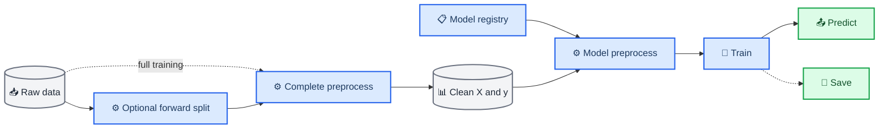

# `src` component usage guide

_CS5228 HDB rent prediction 项目内组件接口说明_

---

## 📋 组件边界

`src` 提供两组公共组件：[`src.preprocessing`](src/preprocessing/) 负责模型共享的数据清洗、特征扩充和时间切分，[`src.models`](src/models/) 负责统一模型接口、模型注册、自动发现和实例化。调用方只应使用两个 package 的公开导出，不应依赖模块内部变量。



公共 preprocessing 和模型内部 `_preprocess()` 属于不同层次。公共 `preprocess()` 一次性完成业务字段清洗以及 block、amenities、lagged COE 特征扩充，所有模型收到相同结构的 `X_clean`；模型 `_preprocess()` 只负责从中选择本变体需要的列并转换成算法要求的输入格式。

## 📊 `src.preprocessing`

所有公开函数都可以从 `src.preprocessing` 导入：

```python
from src.preprocessing import (
    add_lagged_coe,
    forward_split,
    join_block_features,
    make_amenity_features,
    preprocess,
    prepare_core,
)
```

### 核心预处理

接口：

```python
preprocess(
    X_raw: pd.DataFrame,
    *,
    label: bool,
    auxiliary_config: dict | None = None,
) -> pd.DataFrame | tuple[pd.DataFrame, pd.Series]
```

调用示例：

```python
import pandas as pd

from src.preprocessing import preprocess


X_raw = pd.read_csv("data/train.csv")
X_clean, y_clean = preprocess(X_raw, label=True)
```

`label` 是必须显式传入的关键字参数。`label=True` 返回 `(X_clean, y_clean)`；`label=False` 只返回 `X_clean`。`auxiliary_config` 是为后续可配置辅助特征预留的接口，默认值为 `None`；当前传入任何非 `None` 值都会抛出 `NotImplementedError`。它暂时不改变已有的 block、amenities 和 lagged COE 处理。`preprocess()` 不会原地修改 `X_raw`。当前转换包括：

- 规范化 `TOWN`、`BLOCK`、`STREET` 和 `FLAT_MODEL` 的大小写与空格
- 将 `4 room`、`4-room` 等 `FLAT_TYPE` 写法统一
- 生成 `APPROVAL_YEAR`
- 生成从 2021 年起计算的 `MONTH_INDEX`
- 生成 `LEASE_AGE`
- 连接 HDB block 空间和楼龄特征
- 生成并连接 MRT、小学和商场设施特征
- 连接上一个月的 COE 中位数

该函数会从项目内 `data/auxiliary/` 读取辅助表，返回所有模型共用的完整 `X_clean`。具体模型再通过自身 `_preprocess()` 选择需要的特征，不应在训练入口中提前按模型处理数据。

### 特征和目标输出

处理带标签的训练数据时传入 `label=True`。此时输入必须包含 `MONTHLY_RENT`，该列会从 `X_clean` 中移除并作为 `y_clean` 返回；缺少该列时函数会抛出 `ValueError`：

```python
X_clean, y_clean = preprocess(
    pd.read_csv("data/train.csv"),
    label=True,
)

assert "MONTHLY_RENT" not in X_clean.columns
```

处理无需标签的数据时传入 `label=False`，函数只返回特征表。即使输入意外包含 `MONTHLY_RENT`，该列也不会进入 `X_clean`：

```python
X_test = preprocess(
    pd.read_csv("data/test.csv"),
    label=False,
)

assert "MONTHLY_RENT" not in X_test.columns
```

### 低层特征组件

下面的函数是 `preprocess()` 内部使用的低层组件。标准训练和预测流程只调用 `preprocess()`；只有研究单项特征或编写自定义管线时才需要直接调用这些函数。

#### HDB block 特征

接口：

```python
join_block_features(
    core: pd.DataFrame,
    blocks: pd.DataFrame,
) -> pd.DataFrame
```

调用示例：

```python
X_core = prepare_core(X_raw)
blocks = pd.read_csv("data/auxiliary/sg-hdb-block.csv")
X_block = join_block_features(X_core, blocks)
```

函数通过 `TOWN`、`BLOCK`、`STREET` 连接楼栋表，加入经纬度、最高楼层、建成年份和区域，并生成 `BUILDING_AGE`。楼栋查询表必须在三列地址键上唯一。

#### 静态设施特征

接口：

```python
make_amenity_features(
    blocks: pd.DataFrame,
    mrt: pd.DataFrame,
    schools: pd.DataFrame,
    malls: pd.DataFrame,
) -> pd.DataFrame
```

调用示例：

```python
mrt = pd.read_csv("data/auxiliary/sg-mrt-stations.csv")
schools = pd.read_csv("data/auxiliary/sg-schools.csv")
malls = pd.read_csv("data/auxiliary/sg-shopping-malls.csv")

amenities = make_amenity_features(
    blocks=blocks,
    mrt=mrt,
    schools=schools,
    malls=malls,
)

X_enriched = X_block.merge(
    amenities,
    on=["TOWN", "BLOCK", "STREET"],
    how="left",
    validate="many_to_one",
)
```

输出包含最近 MRT、小学和商场距离，以及每类设施在一公里内的数量。该组件只生成每个 HDB block 的设施特征，不自动连接租赁记录。

#### 上一月 COE 特征

接口：

```python
add_lagged_coe(
    frame: pd.DataFrame,
    coe: pd.DataFrame,
) -> pd.DataFrame
```

调用示例：

```python
coe = pd.read_csv("data/auxiliary/sg-coe-prices.csv")
X_with_coe = add_lagged_coe(X_enriched, coe)
```

函数按月份计算所有类别和轮次的 COE premium 中位数，再连接租赁审批月份的上一个月。最早月份找不到上一月数据时允许保留缺失值。

### 时间前向切分

接口：

```python
forward_split(
    frame: pd.DataFrame,
    *,
    train_end: str,
    valid_start: str,
    valid_end: str | None = None,
) -> tuple[pd.DataFrame, pd.DataFrame]
```

调用示例：

```python
raw = pd.read_csv("data/train.csv")

train_raw, valid_raw = forward_split(
    raw,
    train_end="2024-09",
    valid_start="2024-10",
    valid_end="2025-03",
)

X_train, y_train = preprocess(train_raw, label=True)
X_valid, y_valid = preprocess(valid_raw, label=True)
```

函数要求训练截止月份早于验证起始月份，并拒绝空分区和时间重叠。返回的训练表与验证表都是独立副本。训练实验先切分原始数据，再分别调用 `preprocess()`，避免反复合并和拆分标签。

## 📚 `BaseRegressionModel`

所有具体回归模型必须继承 [`BaseRegressionModel`](src/models/base.py)。构造函数分别浅拷贝模型配置和训练配置，并将底层模型占位符初始化为 `self.model = None`。基类只约束模型接口，不承担数据验证，也不会在创建包装类实例时初始化底层 estimator。

### 配置分工

| 配置 | 保存内容 | 示例 |
| --- | --- | --- |
| `model_name` | Registry 中的模型注册名 | `hgb`、`catboost`、`median` |
| `auxiliary_config` | 预留的可配置辅助特征设置 | 当前固定为 `None` |
| `model_config` | 特征变体、输入列和模型构造参数 | `variant`、`features`、`depth`、`max_leaf_nodes` |
| `training_config` | 拟合过程使用的超参数 | `iterations`、`learning_rate`、`random_seed`、`thread_count` |
| `save_path` | 该变体的模型保存位置 | `chkpt/hgb/core.joblib` |
| `submit_path` | Kaggle 提交文件位置 | `output/submit/hgb/core.csv` |
| `eval_path` | 三类时间验证结果位置 | `output/eval/hgb/core.json` |
| `analysis_path` | Holdout 误差分析结果位置 | `output/analysis/hgb/core.json` |

`model_config` 和 `training_config` 在模型实例中分别保存为 `self.model_config` 和 `self.training_config`。`model_name`、`auxiliary_config` 与四个输出路径由根目录入口读取，不传入模型构造函数；入口会把 `auxiliary_config` 传给公共 `preprocess()`。具体模型负责解释自身支持的字段，不应把模型名、辅助数据设置、特征变体或输出路径放进 `training_config`。

### 统一接口

| 方法 | 输入 | 输出 | 责任 |
| --- | --- | --- | --- |
| `_model_init` | 无 | `None` | 初始化底层 estimator 并写入 `self.model` |
| `_preprocess` | `X_clean` | 模型输入 | 转换模型专属输入格式 |
| `train` | `X_train, y_train` | `None` | 训练并设置 `self.model` |
| `predict` | `X_clean` | `np.ndarray` | 返回每行对应的预测值 |
| `save` | `str` 或 `Path` | `None` | 基类统一保存完整模型对象 |

抽象签名：

```python
class BaseRegressionModel(ABC):
    def __init__(
        self,
        model_config: dict[str, Any],
        training_config: dict[str, Any],
    ) -> None:
        self.model_config = dict(model_config)
        self.training_config = dict(training_config)
        self.model: Any | None = None

    @abstractmethod
    def _model_init(self) -> None:
        ...

    @abstractmethod
    def _preprocess(self, X_clean: pd.DataFrame) -> Any:
        ...

    @abstractmethod
    def train(
        self,
        X_train: pd.DataFrame,
        y_train: pd.Series | np.ndarray,
    ) -> None:
        ...

    @abstractmethod
    def predict(self, X_clean: pd.DataFrame) -> np.ndarray:
        ...

    def save(self, path: str | Path) -> None:
        destination = Path(path)
        destination.parent.mkdir(parents=True, exist_ok=True)
        joblib.dump(self, destination)
```

模型生命周期为：

```text
create_model()
  -> 创建模型包装类，self.model 保持 None
train()
  -> 调用 _model_init()
  -> 在 self.model 中得到底层 estimator
  -> 使用训练数据拟合 self.model
predict() / save()
  -> 使用已经训练的 self.model
```

`_model_init()` 只负责根据 `model_config` 和 `training_config` 创建底层模型，不读取训练数据，也不执行 `fit()`。这样创建 registry 实例时不会提前分配模型资源，只有真正训练时才初始化。

### Shape contract

统一接口约定以下 shape：

```text
X_clean / X_train : (n_samples, n_features)
y_train           : (n_samples,)
y_predict         : (n_samples,)
```

这是调用方和具体模型共同遵守的接口契约，不由 `BaseRegressionModel` 执行运行时检查。数据完整性、行数匹配和有限值检查应放在 preprocessing、实验入口或专门的 evaluation 组件中。

### `_preprocess()` 的边界

模型 `_preprocess()` 根据 `model_config["features"]` 选择特征列，再转换类别 dtype、填充模型专属缺失值，并返回底层模型所需的 DataFrame、NumPy 数组或其他输入对象。`features["numeric"]` 和 `features["categorical"]` 同时约定输入列及其类型；公共 `preprocess()` 可以继续向 `X_clean` 增加辅助特征，而未在当前变体配置中列出的列会被模型忽略。

模型 `_preprocess()` 不负责读取 CSV、规范化原始地址、连接辅助表、切分训练集或计算指标。这些工作应在模型调用前完成。

## 🧠 实现具体模型

当前从原仓库迁移了三个模型族。不同实验版本通过 `model_config["variant"]` 选择，模型类内部不保存另一套隐藏的默认超参数。

| 注册名 | `variant` | 输入特征 |
| --- | --- | --- |
| `median` | `global_median` | 不使用特征，输出训练标签全局中位数 |
| `median` | `town_flat_type` | 配置为 `TOWN`、`FLAT_TYPE`，依次回退到 town 中位数和全局中位数 |
| `hgb` | `core` | 核心时间、面积、房龄及类别特征 |
| `hgb` | `block` | core 加 HDB block 空间特征 |
| `hgb` | `amenities` | block 加六个设施距离与数量特征 |
| `catboost` | `block` | block 加 `STREET` 和组合地址 |
| `catboost` | `amenities` | CatBoost block 加六个设施特征 |
| `catboost` | `lagged_coe` | CatBoost block 加前一个月 COE 中位数 |

`model_config` 必须包含 `variant` 和 `features`。`features` 按 `numeric`、`categorical` 保存该变体实际消费的列，不传给底层 estimator；模型类移除 `variant` 和 `features` 后，将剩余模型构造参数与 `training_config` 合并。每个变体的两个配置字典和四个输出路径保存在 `configs/<模型>/<变体>.py` 中，例如：

```python
model_name = "hgb"
auxiliary_config = None

model_config = {
    "variant": "block",
    "features": {
        "numeric": [
            "MONTH_INDEX",
            "FLOOR_AREA_SQM",
            "LEASE_AGE",
            "LATITUDE",
            "LONGITUDE",
            "MAX_FLOOR",
            "BUILDING_AGE",
        ],
        "categorical": ["TOWN", "FLAT_TYPE", "FLAT_MODEL", "REGION"],
    },
    "categorical_features": "from_dtype",
    "max_leaf_nodes": 31,
}
```

新增辅助特征时，先在公共 `preprocess()` 中生成对应列，再把列名加入需要使用它的变体配置；数值特征放进 `features["numeric"]`，类别特征放进 `features["categorical"]`。无需修改 HGB 或 CatBoost 模型类。

根目录的 `train.py`、`eval.py`、`analysis.py` 和 `submit.py` 都只接收 `--config_path`，例如 `python train.py --config_path configs/hgb/block.py`。入口直接执行该配置文件，从顶层 `model_name` 获取 registry 名称，并从 `model_config["variant"]` 获取变体名称，因此无需在命令行重复填写二者。

配置可以按以下方式导入：

```python
from configs.hgb.core import (
    analysis_path,
    auxiliary_config,
    eval_path,
    model_config,
    model_name,
    save_path,
    submit_path,
    training_config,
)
```

HGB 的 `_preprocess()` 会填充类别缺失值并转换为 pandas `category`，类别映射由 sklearn 的内部 encoder 保存；CatBoost 的 `_preprocess()` 会生成组合地址，把类别缺失值填为 `"unknown"` 并转换为字符串。具体模型不需要实现 `save()`，统一继承基类的 joblib 保存逻辑。

Median 不在模型类中写死分组列。它读取 `model_config["features"]["categorical"]`，先使用完整类别组合计算中位数，再按配置中的列顺序从末尾逐列移除并建立回退统计，最后回退到全局中位数。当前 `town_flat_type` 配置为 `["TOWN", "FLAT_TYPE"]`，所以实际行为仍是组合中位数、town 中位数、全局中位数。

具体模型模块被自动发现时会执行 import，因此模块顶层只能定义常量、函数和类。不要在模块 import 阶段读取数据、训练模型或写文件。

## 🔗 模型 registry

Registry 位于 [`src/models/registry.py`](src/models/registry.py)，公共 API 从 `src.models` 导出：

```python
from src.models import (
    available_models,
    create_model,
    get_model_class,
    register_model,
)
```

### 注册模型

在具体模型类上添加注册装饰器：

```python
from src.models.base import BaseRegressionModel
from src.models.registry import register_model


@register_model("catboost")
class CatBoostRegressionModel(BaseRegressionModel):
    ...
```

注册名会去除首尾空格并转为小写。重复名称会抛出 `ValueError`，没有继承 `BaseRegressionModel` 的类会抛出 `TypeError`。

### 自动发现

第一次调用 `create_model()`、`get_model_class()` 或 `available_models()` 时，registry 会扫描并导入 `src/models/` 中的模块。以下模块不会作为具体模型导入：

- `base.py`
- `registry.py`
- 以下划线开头的模块

新增模型只需要创建模型文件并使用 `@register_model(...)`，不需要修改 `src/models/__init__.py`，调用方也不需要 import 具体模型文件。

### 创建和查看模型

```python
from configs.catboost.amenities import model_config, training_config
from src.models import available_models, create_model


print(available_models())

model = create_model(
    "catboost",
    model_config=model_config,
    training_config=training_config,
)
```

`create_model()` 会把两个配置分别传给具体模型构造函数，但不会调用 `_model_init()`；新实例的 `self.model` 仍然是 `None`。迁移后的正式模型需要在 `model_config` 中给出 `variant`、`features` 和必要的 estimator 构造参数。

当前 `available_models()` 返回 `("catboost", "hgb", "median")`。

## ⚙️ 组合调用示例

实验入口只导入公共组件，不导入具体模型类：

```python
from pathlib import Path

import numpy as np
import pandas as pd

from configs.hgb.core import (
    auxiliary_config,
    model_config,
    model_name,
    save_path,
    training_config,
)
from src.models import create_model
from src.preprocessing import forward_split, preprocess


ROOT = Path(__file__).resolve().parent

raw = pd.read_csv(ROOT / "data" / "train.csv")
train_raw, valid_raw = forward_split(
    raw,
    train_end="2024-09",
    valid_start="2024-10",
    valid_end="2025-03",
)

X_train, y_train = preprocess(
    train_raw,
    label=True,
    auxiliary_config=auxiliary_config,
)
X_valid, y_valid = preprocess(
    valid_raw,
    label=True,
    auxiliary_config=auxiliary_config,
)

model = create_model(
    model_name,
    model_config=model_config,
    training_config=training_config,
)
model.train(X_train, y_train)
y_predict = model.predict(X_valid)

rmse = float(np.sqrt(np.mean((y_predict - y_valid.to_numpy()) ** 2)))
print(f"Validation RMSE: {rmse:.2f}")

model.save(ROOT / save_path)
```

切换模型时只修改注册名、`model_config` 和 `training_config`，数据准备、训练调用、预测接口及输出 shape 保持不变。
